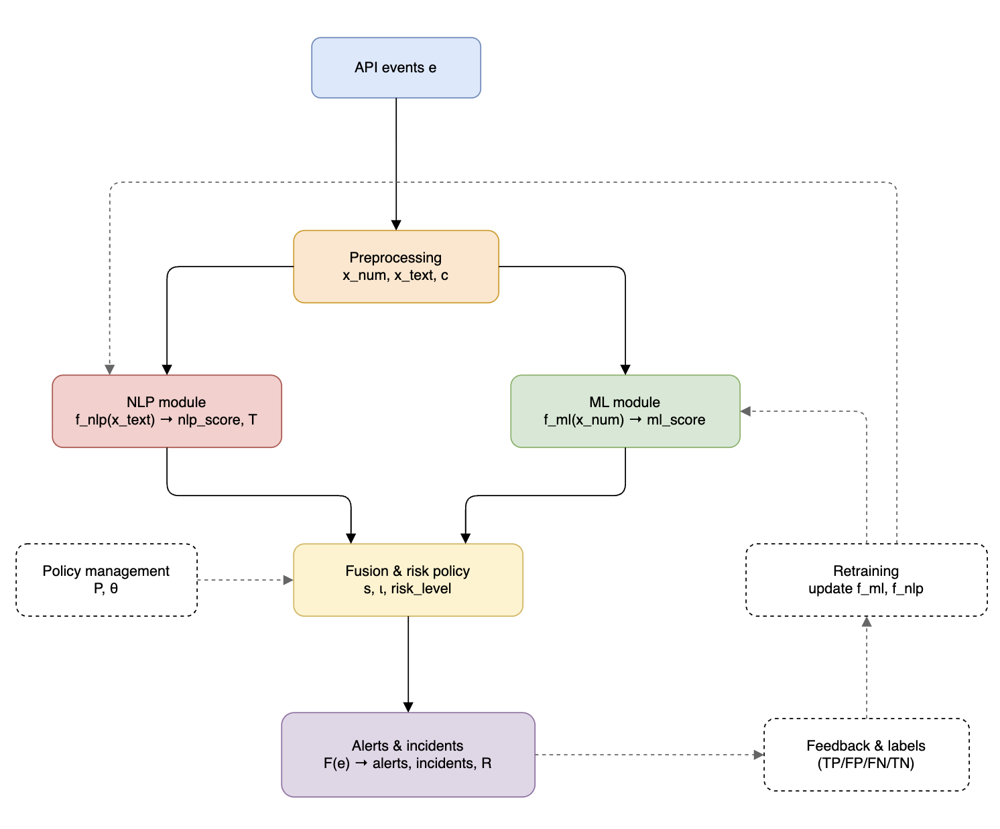

# ML/NLP Anomaly Detection Pipeline

This repository contains a microservice-based risk/anomaly detection pipeline for HTTP traffic.  
It combines:

- **ML on numeric features** (Isolation Forest, One-Class SVM, Autoencoders)
- **NLP on raw payloads / logs** (TF-IDF + Logistic Regression, character-level SGD, rules)
- **Context-aware risk scoring** (OWASP Top-10, impact policy)
- **Alerting & fan-out** (OpenSearch, Slack, email, ServiceNow, Redis DLQ)

The system is designed to run in **Kubernetes/EKS**, but ships with a **Docker Compose** setup for local experimentation.

## Training Datasets

This project does **not** ship any third-party datasets in the repo.  
Instead, the retraining job expects CSV files that you can build from public datasets.

### NLP (Text) Datasets

The NLP models (`nlp_tfidf_lr*.joblib`, `nlp_char_sgd*.joblib`) are trained on HTTP parameter payloads derived from:

#### 1. HttpParamsDataset

Kaggle: <https://www.kaggle.com/datasets/evg3n1j/httpparamsdataset?select=payload_full.csv>

- Each record is a **value of an HTTP request parameter**.
- Total payloads: ~31k
  - **Benign** values (`norm`): 19,304
  - **Anomalous** values (`anom`): 11,763
- Anomalies are split into attack types:
  - SQL Injection (`sqli`) — 10,852
  - Cross-Site Scripting (`xss`) — 532
  - Command Injection (`cmdi`) — 89
  - Path Traversal (`path-traversal`) — 290

The dataset itself was built from several sources:

- **CSIC2010** benign HTTP payloads
- **sqlmap** – SQL injection samples
- **xssya** – XSS payloads
- **Vega Scanner** – Command Injection & Path Traversal samples
- **FuzzDB** – extra XSS / Command Injection / Path Traversal payloads

#### 2. Web Application Payloads Dataset
Kaggle: https://www.kaggle.com/datasets/cyberprince/web-application-payloads-dataset

Curated web attack payloads for red-teaming and NLP:
- SQL Injection (SQLi)
- Cross-Site Scripting (XSS)
- Server-Side Request Forgery (SSRF)
- Command Injection (CMDi)
- CSRF-related payloads

### Numeric ML (Tabular) Datasets

The numeric ML models (if_model.joblib, ocsvm_model.joblib, ae_model.joblib, lstm_ae_model.joblib, ml_rules_clf.joblib) are trained on features built from HTTP and network traffic.

We currently use two main public sources:

1. CSIC 2010 Web Application Attacks
Kaggle: https://www.kaggle.com/datasets/ispangler/csic-2010-web-application-attacks?select=csic_database.csv
-	HTTP traffic with normal vs attack requests against a web application.
-	Includes:
-	Normal web traffic
-	SQL Injection
-	XSS
-	CSRF
-	Other web application attacks

2. Attack Simulation Lab (PCAP → CSV)
Kaggle:
https://www.kaggle.com/datasets/moradrawashdeh/attack-simulation-lab?select=attack-simulation-alert.csv

This dataset comes from a controlled lab environment:
-	Kali machine (10.20.30.103) – source of attack traffic (various tools).
-	OWASP Broken Web Application (10.20.30.101) – target of attacks.
-	Normal Windows PC (10.20.30.1) – source of benign traffic.

Key points:
-	Raw traffic captured as PCAP, then converted to CSV using Tshark.
-	Each row = one network packet, with fields for:
-	Frame metadata (frame.*)
-	Ethernet, IP, IPv6
-	TCP/UDP/ICMP
-	HTTP, DNS, SMTP, POP, IMAP, FTP
-	An extra alert column marks each packet as:
-	"benign" – normal traffic (mostly from the Windows PC)
-	"suspicious" – attack traffic (mostly from Kali → OWASP BWA)

These two sources are then merged into a unified numeric dataset (/data/ml_numeric.csv) that powers:
-	Isolation Forest (if_model.joblib)
-	One-Class SVM (ocsvm_model.joblib)
-	Dense Autoencoder (ae_model.joblib)
-	LSTM Autoencoder (lstm_ae_model.joblib)
-	Rules-supervised classifier (ml_rules_clf.joblib)

## High-Level Architecture

Conceptually, one HTTP/log event flows through these stages:
1.	Preprocess service
-	Normalises the incoming JSON event (ts, endpoint, method, headers, payload, etc.).
-	Extracts numeric features (lengths, entropies, rates, etc.).
-	Builds text fields for NLP.
-	Derives risk context (env, endpoint_class, data_class, auth_state, exposure, blast).
2.	ML inference service (ml_infer)
-	Takes numeric_feats and hash_id.
-	Runs multiple anomaly models (IF, OCSVM, Dense AE, LSTM AE) + a rules-supervised classifier.
-	Aggregates them into a single ml_score in [0, 1] with per-model calibration.
3.	NLP inference service
-	Takes text fields (endpoint, headers, payload, etc.).
-	Runs:
-	Global models (e.g. tfidf_lr, char_sgd).
-	Per-attack models (e.g. tfidf_lr__sql_injection, char_sgd__business_logic).
-	Rule-based detections (regex / patterns).
-	Produces:
-	nlp_score in [0, 1]
-	A list of topics (e.g. SQL Injection, Business Logic Abuse) with confidences.
4.	Fusion / Orchestrator
-	Combines ml_score + nlp_score using adaptive weights.
-	Applies an impact policy (policies/impact_policy.json) based on OWASP Top-10:
-	environment (dev / stage / prod)
-	endpoint class (payments, auth, admin, profile, files, webhook, public_api, report_export, …)
-	data class (generic, pii, pci, tokens, credentials, secrets, …)
-	auth state (anonymous, user, admin, service, third_party_app)
-	exposure (internal / public)
-	blast radius (low / med / high)
-	Computes:
-	final_score in [0, 1]
-	risk_level ∈ {normal, low, medium, high, critical}
-	is_anomaly (boolean)
-	Exposes a single entrypoint: POST /process.
5.	Alerting service (alerting)
-	Receives a FusionSnapshot from orchestrator.
-	Applies:
-	deduplication (Redis + in-memory fallback)
-	risk gating (ALERT_MIN_RISK).
-	Builds a human-readable summary and “recommended actions” using policies/recommended_actions.json.
-	Fans out alerts to configured sinks:
-	Local logs
-	OpenSearch (alerts-*, incidents-*)
-	Slack webhook
-	Email (SMTP)
-	ServiceNow
6.	Retrain job (retrain)
-	Periodically (or on demand) rebuilds ML and NLP models from datasets.
-	Writes artefacts to:
-	/models/ml/… for ML
-	/models/nlp/… for NLP
-	Produces corresponding *.meta.json with calibration/metrics.

## Models & Features

### Numeric ML (Tabular)

The ML inference service works over a fixed feature vector built in preprocess.

Core features include (non-exhaustive):
-	endpoint_len
-	header_count
-	payload_size
-	headers_entropy
-	query_param_count
-	path_depth
-	suspicious_char_ratio
-	is_json_payload
-	http_method_code

Models:
-	Isolation Forest (if)
-	One-Class SVM (ocsvm)
-	Dense Autoencoder (ae)
-	LSTM Autoencoder (lstm_ae)
-	Rules-supervised classifier (HistGradientBoostingClassifier over rule features)

### NLP (Text)

The NLP side uses:
-	TF-IDF + Logistic Regression (bag-of-words)
-	Character-level SGD classifier
-	Per-attack models:
-	__sql_injection, __xss, __nosql_injection,
__ldap_injection, __cmd_injection, __ssrf,
__ssrf_sensitive, __api_key_exposure, __auth_bruteforce,
__credential_stuffing, __idor, __misconfiguration,
__data_exposure, __dos, __websocket, __business_logic, …
-	A rules engine that tags suspicious payloads (SQLi/XSS/SSRF/etc.) based on regexes and patterns
from policies/rules/base_rules.json.

Training data is assembled into nlp_train.csv and then expanded into a silver-labeled dataset
nlp_train_silver.csv with per-attack labels.

## Risk Scoring & Impact Policy

Final risk is not just anomaly scores – it’s also the context.

The file policies/impact_policy.json controls:
-	Base weights for:
-	env (dev, stage, prod)
-	endpoint_class (payments, auth, admin, profile, files, webhook, public_api, report_export, …)
-	data_class (generic, pii, pci, tokens, credentials, secrets, …)
-	auth_state (anonymous, user, admin, service, third_party_app)
-	exposure (internal, public)
-	blast (low, med, high)
-	Topic caps and escalations per OWASP Top-10 category, e.g.:
-	SQLi, Command Injection, Cloud Metadata SSRF, API key exposure get higher caps.
-	Misconfiguration, WebSocket abuse, noisy DoS get more moderate caps.
-	Mapping from (impact, final_score) to a risk level matrix:
-	normal / low / medium / high / critical.

ML + NLP + impact -> final_score, risk_level -> alerting.

## Alerting & Recommended Actions

The alerting service:
-	Authenticates requests from the orchestrator via X-Orch-Token (optional).
-	Deduplicates alerts by hash_id using Redis (and an in-memory fallback).
-	Gates alerts by minimum severity: ALERT_MIN_RISK (e.g. medium).

It then builds a human-readable alert using build_human_alert() and merges in
topic-specific recommended actions from policies/recommended_actions.json, e.g.:
```
{
  "default": [
    "Review recent requests from same IP/user",
    "Apply temporary rate limiting or block",
    "Validate inputs and review server logs around timestamp"
  ],
  "topics": {
    "SQL Injection": [
      "Check DB query logs for suspicious patterns",
      "Review ORM/SQL construction around endpoint",
      "Tighten WAF rules for SQLi patterns"
    ],
    "Business Logic Abuse": [
      "Implement idempotency/atomic checks",
      "Add server-side validations",
      "Rate-limit sensitive actions"
    ]
  }
}
```

Supported sinks (via ALERT_SINKS env, comma-separated):
-	local (logs)
-	os_alerts (OpenSearch alerts-*)
-	opensearch (incidents index with richer document)
-	slack
-	email
-	servicenow

## Datasets & Retraining

The retrain job (jobs/retrain/main.py) can:
-	Download and merge network / log datasets (e.g. CSIC 2010, Attack Simulation Lab) into
/data/ml_numeric.csv with our numeric feature schema.
-	Build a rules-supervised dataset ml_rules_silver.csv from the NLP “silver” labels.
-	Build nlp_train.csv (HttpParamsDataset + synthetic benign traffic).
-	Train and save:
-	if_model.joblib
-	ocsvm_model.joblib
-	ae_model.joblib
-	lstm_ae_model.joblib
-	ml_rules_clf.joblib
-	nlp_tfidf_lr*.joblib
-	nlp_char_sgd*.joblib

Each model is saved under:
-	/models/ml/…
-	/models/nlp/…

with meta files like *.meta.json containing:
-	feature_order
-	calibration (mu, sigma)
-	metrics (roc_auc_label, pr_auc_label, best_f1_label, …)
-	optional recommended_threshold.

The ML inference service reads these meta files at startup and automatically:
-	loads calibration for each anomaly model
-	infers recommended thresholds if not overridden by ML_THRESHOLD.

## Running Locally

Requirements
-	Docker & Docker Compose
-	Python 3.11+ (for the OWASP test tool and any local scripts)

Quick Start
	1.	Clone the repo

git clone git@github.com:aziz-abibulaiev/nlp-ml-logs-analyzer.git
cd ml-nlp-eks-proto


	2.	(Optional) Prepare .env
You can override things like:

```sh
# Core
ORCH_TOKEN=changeme
LOG_LEVEL=INFO

# Alerting
ALERT_SINKS=local,os_alerts
ALERT_MIN_RISK=medium

# Slack / email / SNOW (optional)
SLACK_WEBHOOK_URL=...
EMAIL_SMTP_HOST=...
EMAIL_TO=...
SERVICENOW_URL=...
SERVICENOW_USER=...
SERVICENOW_PASS=...
```

	3.	Build & run services

```sh
docker compose build
docker compose up -d
```

Common services include (names may differ slightly):
-	preprocess
-	ml_infer
-	nlp_infer
-	orchestrator (exposes /process)
-	alerting
-	retrain (one-shot for training)
-	redis
-	opensearch

	4.	Train models (if retrain is not auto-run)
If your docker-compose.yaml doesn’t already run retrain, you can:

```sh
docker compose run --rm retrain
```

This will:
-	use the configured datasets (or local CSVs),
-	build ml_numeric.csv, nlp_train.csv,
-	save models under /models/ml/ and /models/nlp/.


## Example Usage

Simple request to /process

Assuming the orchestrator is mapped to localhost:8000:
```sh
curl -sS -f "http://localhost:8000/process" \
  -H 'Content-Type: application/json' \
  --data-binary @- << 'EOF'
{
  "event": {
    "ts": "2025-11-26T15:33:19Z",
    "endpoint": "/payments/refund",
    "method": "POST",
    "headers": {
      "ct": "text"
    },
    "payload": "apply coupon SAVE10 twice to get double discount",
    "latency_ms": 123,
    "trace_nonce": "1764171199960740000",
    "source_ip": "198.51.100.42",
    "user_id": ""
  }
}
EOF
```

The pipeline processes the event, and if it’s anomalous with sufficient risk,
the alerting service will emit a human-readable summary and send it to configured sinks.

## Testing tools

###  OWASP Top-10 Smoke Test

The tools/owasp_top_10_test.py script generates traffic covering ~OWASP Top-10 topics
(SQLi, XSS, SSRF, Business Logic Abuse, etc.) against /process.
```python
python tools/owasp_top_10_test.py \
  --url http://localhost:8000 \
  --path-process /process \
  --detailed \
  --csv-out owasp_runs.csv \
  --xlsx-out owasp_runs.xlsx
```

-	--detailed asks orchestrator to return the full internal JSON
(preprocess + ML + NLP + fusion + alert preview).
-	--csv-out / --xlsx-out export a table with useful columns, e.g.:
-	timestamp
-	endpoint / method / payload
-	source_ip / user_id
-	attack_type_identified
-	risk_level
-	final_score / thresholds
-	ml_score / nlp_score
-	topic / topic_score
-	env / endpoint_class / data_class / auth_state / exposure / blast
-	response_raw (for debugging)

### Log file format testing

The `tests/gen_log_file_attacks.py` script generates synthetic logs with OWASP-style attacks in several formats. It is useful for testing how the pipeline behaves on access logs and cloud-native log formats.

Supported formats (`--kind`):
- `access` – Apache/Nginx-style access log lines (default).  
- `cloudwatch` – JSONL records similar to AWS CloudWatch Logs. (TODO) 
- `cloudtrail` – JSONL records wrapped as CloudTrail `Records`. (TODO)

Basic usage:
```bash
# Create 100 Apache-style access.log entries with mixed attack types
python tests/gen_log_file_attacks.py \
  --kind access \
  --count 100 \
  --out tests/access_attacks.log

# Post generated access.log to pipeline
curl -X POST "http://localhost:8000/replay_access_log?concurrency=20" \
  -H "Content-Type: application/json" \
  -d '{"path": "tests/access_attacks.log"}'
```

If `--out` is omitted, the script uses default paths:
- `tests/access_attacks.log` for `--kind access`
- `tests/cloudwatch_attacks.jsonl` for `--kind cloudwatch`
- `tests/cloudtrail_attacks.jsonl` for `--kind cloudtrail`

These files can be used with any tooling or endpoints that accept Apache-style access logs or JSONL events to verify that OWASP-style attacks are correctly detected, scored, and turned into alerts/incidents by the pipeline.

## Observability & Operations

Each service exposes Prometheus metrics at `/metrics`
(e.g. `alert_requests_total`, `ml_score_latency_seconds`, etc.) and basic health endpoints:
- `/health` – basic “I’m alive” probe.
- `/ready` – deeper checks (models loaded, OpenSearch reachable, Redis ok, etc.).

The alerting service also supports:
- `POST /reload_actions` – reloads `policies/recommended_actions.json` without a restart.
- `POST /replay_dlq` – retries alerts that previously failed to be stored in OpenSearch (DLQ replay).

### OpenSearch & Dashboards

By default, our docker compose env also starts:
- **OpenSearch** on `http://localhost:9200`
- **OpenSearch Dashboards** on `http://localhost:5601`

The alerting service writes documents into daily indices:
- `alerting-YYYY-MM-DD` – individual alerts
- `incidents-YYYY-MM-DD` – aggregated incidents

To explore them in Dashboards:

1. Open **OpenSearch Dashboards** -> *Stack Management* -> *Index Patterns*.
2. Create index patterns, for example:
   - `alerting-*` (for `alerting-YYYY-MM-DD`)
   - `incidents-*` (for `incidents-YYYY-MM-DD`)
3. Set `context.ts` (or `@timestamp` if you map it) as the time field for time-based visualizations.

There is a starter dashboard/visualization export in:
- `opensearch-data/alerts-dashboard-provision-template.ndjson`

You can import it via:
1. **Dashboards** -> *Stack Management* -> *Saved Objects* -> *Import*.
2. Select `alerts-dashboard-provision-template.ndjson`.
3. When prompted, map the index reference used in the NDJSON to your `alerting-*` index pattern.

This will create:
- a “Total Attacks Over Time” histogram,
- an “Attacks by Topic” pie chart,
- and two tables (“Top 10 Attacks by Impact” and “Detailed Attack View”) bound to the `alerting-*` indices, so you can immediately see how the pipeline classifies and scores attacks in near real time.